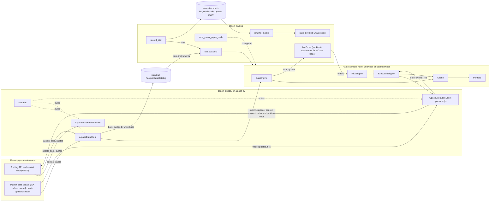

# Architecture

How the pieces fit together on `main`. Each statement names the file or record it rests on; the records
outrank this page. What is planned is in [roadmap.md](roadmap.md).

## Layers

| Layer | What it is | Rests on (pin) | Code | Decided by |
|---|---|---|---|---|
| Venue | Alpaca's paper Trading API, its market data (the IEX feed unless a subscription or request names another) and its two streams | Alpaca's docs; `alpaca-py` v0.45.0 | none here | ADR 0009, 0055 |
| Adapter | Instrument provider, data client, execution client, factories, in upstream's five modules | `alpaca-py` v0.45.0; `requests` v2.34.2, for the HTTP timeout alpaca-py does not set; NautilusTrader's adapter guide and template (template at v2.0.0rc8) | `packages/canon-alpaca/` | ADR 0009, 0012, 0024, 0030, 0036, 0038, 0039, 0042, 0055 |
| Engine | The node: data, risk and execution engines, cache, portfolio; `BacktestNode` for backtests, `LiveNode` for paper | NautilusTrader v2.0.0rc8 | upstream | ADR 0009 |
| Strategies and node configuration | `MaCross` and `run_backtest` on a simulated `ALPACA` venue; `ema_cross_paper_node`, a paper `LiveNode` running upstream's built-in `EmaCross` under risk limits | NautilusTrader v2.0.0rc8 | `src/canon_trading/` | ADR 0009, 0012, 0037, 0049 |
| Local data | `ParquetDataCatalog` of bars and instruments, ignored by git, filled from Alpaca by `load_bars` | NautilusTrader v2.0.0rc8 | `catalog/`, `canon_trading/bars_to_catalog.py` | ADR 0012, 0040 |
| Trial ledger | One Optuna trial per backtest, in a SQLite study over a fixed sample, in the main checkout and shared by every worktree, ignored by git | Optuna v5.0.0 | `canon_trading/ledger.py`, `ledger/` | ADR 0010, 0035, 0041, 0053, 0054, 0081 |
| Returns matrix | T daily rows, the session days every trial covers over the sample, one column per configuration | pandas v3.1.1; skfolio v1.12.9 `Population` | `canon_trading/returns_matrix.py` | ADR 0010, 0041, 0080 |
| Gate | The pick's deflated Sharpe ratio against 0.95, N = every trial | skfolio v1.12.9 | `canon_trading/ranking.py` | ADR 0010, 0031, 0054, 0080, 0081 |

Pins are in `canon/upstreams.json` and `pyproject.toml`, commits in `canon/upstreams.lock.json`. The
adapter is a uv workspace member of its own, kept apart from strategies as upstream keeps them
(ADR 0012; `.claude/rules/trading-safety.md`). Its module layout and limits are in
`packages/canon-alpaca/README.md`.

## A backtest, from catalog to gate

1. Bars and their instrument are in a catalog: from Alpaca through `load_bars`, a `LiveNode` request with
   the catalog's write-back (ADR 0040), or generated, as `tests/test_backtest.py` writes them.
2. `run_backtest` builds one `BacktestNode` per run on a simulated `ALPACA` venue: `NETTING`, `CASH`,
   `L1_MBP` bar execution, a zero-rate fee model; no slippage, latency or market-hours model (`backtest.py`).
3. `record_trial` asks the study for a trial, runs it over the study's sample, and tells it `COMPLETE`
   (traded) or `FAIL` (failed, idle, or traded with a Sharpe ratio that is not finite), with its config
   key, sample, range, daily returns, session days and data digest (`ledger.py`, ADR 0035, ADR 0041, ADR 0053).
4. `returns_matrix` keeps only daily series and drops closed days; a trial that does not cover every
   session day of the sample stops the ranking, with nothing trimmed, through skfolio's `Population`
   and pandas (`returns_matrix.py`, ADR 0010 step 2, ADR 0041).
5. `rank` picks the highest Sharpe ratio and rejects it below a DSR of 0.95; it stops on any input
   ADR 0031, ADR 0041, ADR 0053, ADR 0054, ADR 0080 and ADR 0081 refuse (`ranking.py`).

`variant_study.py` runs steps 3 to 5 for one pre-registered plan, eight `MaCross` variants on Alpaca's
daily bars (ADR 0048).

## A paper run, from stream to fill

1. A `LiveNode` gets the adapter's factories, both or the data one alone in its paper tests, or both through `ema_cross_paper_node`,
   which adds upstream's `EmaCross` at one share an order (`paper_node.py`, `tests/test_paper_ema_cross.py`, ADR 0037),
   or through `session_window.window_node`, which adds `SessionMaCross` (the table refuses `EmaCross` by
   name, since it sells while flat and a window never opens a short), and the `PositionCap` with the
   execution engine's open-order and position checks on (`session_window.py`, ADR 0044). A window starts
   only on an account Alpaca holds long-only (`no_shorting`, set by `mise run paper:long-only`).
2. On connect the provider loads `Equity` instruments from `/v2/assets`; the data client streams quotes
   and trades, on the feed the first subscription's params name and IEX when they name none, and serves
   historical bars, and IEX quotes, into the data engine, which can write them back into the catalog
   (package README, ADR 0040, ADR 0055, ADR 0066).
3. A strategy's order passes the risk engine, then the execution engine sends it to Alpaca's paper API
   with `paper=True`; denied types never reach Alpaca (package README, ADR 0036).
4. Alpaca's trade updates stream becomes order events; each `fill` or `partial_fill` is an `OrderFilled`
   keyed by Alpaca's `execution_id` (package README, ADR 0024).
5. At start-up the client reports orders, fills from Alpaca's fill activities, open positions, and each
   loaded instrument without a position as flat, for reconciliation (package README, ADR 0024).

A node can take NautilusTrader's sandbox execution client in place of the Alpaca one, matching orders
locally on the data client's live data; nothing in `src/` builds one yet (ADR 0070; the lanes: ADR 0068,
`proposed`).

## Safety boundaries

* **Paper only.** `AlpacaExecutionClientConfig` refuses `paper` other than `True`, any `url_override`
  and any value naming Alpaca's live host, and the client builds alpaca-py's clients with `paper=True`
  whatever the config holds; `test_upstream_contract.py` asserts alpaca-py's trading clients default to
  paper (package README, ADR 0009, ADR 0030). Agents never place, modify or cancel a live order, and
  the record keeps trading on paper at least until NautilusTrader v2.0.0 stable (ADR 0009).
* **The key pairs** are in the login keychain: account A's, service `canon-alpaca-paper`, which only
  `mise run paper:test` and, in data-only mode with every request but GET refused, `mise run paper:data`
  put in an environment (ADR 0070), and account B's, service `canon-alpaca-paper-windows`, which
  only `mise run paper:session` does, each in its own and under its own account's lock; a paper test that
  streams, a window and a sandbox run also take the login's stream lock (`mise.toml`, ADR 0029, ADR 0044,
  ADR 0069, ADR 0070).
  Each pair is checked against the paper API before it is stored (ADR 0033).
* **A session window** holds a position of at most one share: `PositionCap` reads the portfolio every second
  inside the node and shuts the system down over it; the window starts flat, ends flat or fails, and lasts
  at most 60 minutes (ADR 0044); the account check after its stop is ADR 0060.
* **The risk engine** limits submits and modifies only; cancels and queries pass it. `ema_cross_paper_node`
  sets 50 submits and 25 modifies a minute, under Alpaca's working figure of 200 calls a minute, and
  $1,000 notional per order; its paper test allows one submit in five minutes (ADR 0037, ADR 0049). The adapter's
  tester nodes turn the engine off (`LiveRiskEngineConfig(bypass=True)` in `test_paper_matrix.py` and
  `test_paper_execution.py`); a node that sets no limits has upstream's defaults, 100 a second each and
  no notional limit (the pinned package's `RiskEngineConfig`). Where the engine is on, a market order
  with no price is denied (package README).
* **Not enforced by code.** The keychain does not keep a process of this user from reading the pair;
  "agents never read a credential" is an instruction (ADR 0029). No hook runs before a tool call
  (ADR 0020), and the sandbox is not on (ADR 0025). Codex and Muse start in their own sandboxes with
  nothing asking once the owner sets their launch arguments in Orca. Codex's sandbox stops a write to
  `/tmp`, to its workspace's `.git` and outside its workspace; Muse's stops neither. Antigravity, DeepSeek Harness and Claude Code lanes keep
  their bypass flags (ADR 0034). That no live key is on the machine is unverified (ADR 0025).

## The harness

* **Canon.** Every upstream is in `canon/upstreams.json` with role, licence, evidence and record;
  `scripts/canon resolve` writes the commits to the lock (ADR 0001).
* **Records.** Decisions are MADR 4.0.0 with an Evidence section and a `review-by` date, re-verified
  after it (ADR 0002); `scripts/canon lint` checks them.
* **One check.** `scripts/ci` runs every check, on every commit through `.githooks/pre-commit` and on
  GitHub (ADR 0013).
* **Landing.** `scripts/land` runs the check and squash-merges the branch; a change outside a named few
  needs a review note, recorded as the `review` status (ADR 0014, ADR 0017, ADR 0019).
  A trading path leaves the review loop after two rounds with no finding that changes behaviour (ADR 0073;
  ADR 0074 keeps that loop to the trading paths); harness work is capped to one maintenance lane once ADR
  0071's six checks hold; how a runtime is enhanced is proposed (ADR 0072).
* **Proportion.** The trading path (the adapter's order and data paths, the session window, the gate)
  needs a failing test and a paper or simulation run; everything else lands on upstream documentation, a
  landscape comparison and one review (ADR 0074).
* **Reviewer benchmark.** Past commits whose defects a fix and a failing test later confirmed, one brief
  for every reviewer, found-or-missed scoring by two scorers (`evals/review/`, ADR 0046). First run
  2026-11-10, scored in `evals/review/runs/2026-11-10-first/`; the cases hold 23 confirmed defects, 10 in
  `order-modify` and 10 in `trial-ledger-gate`.
* **Build eval.** A past fix's parent tree with the fix's failing tests, in a one-commit copy with no
  history; a harness that grades the worker's files out of its reach, then two readers who say whether
  the change would land (`evals/build/`, ADR 0057). Four cases; no trial has run. It is the measure
  that keeps or retires a runtime, model, effort and configuration that builds here, not a gate: an
  adopted runtime other than Claude Code builds in its own workspace, and a Claude lane or the
  coordinator reviews and lands its change (ADR 0058).
* **Gateway.** OmniRoute on 127.0.0.1 for GPT and other non-Anthropic runtimes, installed on request from
  mise's `gateway` environment, and kept running by a launchd agent that runs `mise -E gateway run omniroute:serve`
  once it is installed; never a
  Claude credential, account or model, and Claude Code keeps its own login. Its storage key is in the
  login keychain, which, as for the paper pair, any process of this user can read; `scripts/bootstrap --check` fails on an Anthropic connection (ADR 0056).
* **Context layers.** None adopted: the runtimes read `AGENTS.md` and take MCP servers, none configured;
  OpenViking, WeKnora, Serena and Context7 are watched until a reviewer trial on the benchmark shows a
  gain (ADR 0051).
* **Unasked.** The commit gate, the push address check, edit-time lint, a daily canon watch, a lane
  watchdog, a weekly model run and Dependabot (ADR 0011, ADR 0016, ADR 0026; `AGENTS.md`, "Automation").
  Once installed, a paper session window about every 35 minutes, run from a clone each firing brings to
  GitHub's `main` first, never from a checkout a person uses (ADR 0050). Every 30 minutes, the
  maintenance agent brings the main checkout to origin/main by fast-forward and reinstalls what differs
  from it, so what lands under `home/` and in the installers reaches the machine at its next round,
  with main's gate as the control (ADR 0065).
  Models are routed by lane in `canon/models.json` (ADR 0005).
* **Coordination.** No recurring duty runs on a session's timer; the queue, the lanes and what waits on
  the lead or the owner are the coordinator's Orca Run, outside the repository, and what has landed is in
  git (ADR 0078).

## Where code runs, and what it has

Read from each process's own environment on 2026-11-10 (`sysctl` `KERN_PROCARGS2`, `launchctl print`, the
hosted run's log), on macOS with mise 2026.11.5 and Orca 1.4.255. "mise's" is a directory `mise env --paths`
lists; "system" is `/usr/bin` or `/bin`. Secret variables are named, never shown.

| Way of running | PATH starts with | `python3` | `uv`, `gh` | `jq`, `git`, `bash` | Claude config | Model and effort come from |
|---|---|---|---|---|---|---|
| First agent in a workspace Orca creates (`orca.yaml` setup, then Orca's startup script under `bash -lc`): Claude, Codex, Antigravity, Muse, DeepSeek Harness | `/etc/paths`, `/etc/paths.d`, then mise's | system 3.9 | mise's | system; bash 3.2 | `~/.claude` (`CLAUDE_CONFIG_DIR` unset unless Orca's profile pointer names a folder) | Claude: `--model`, `--effort` from the dispatch; the others: their own config (`~/.codex`, `~/.gemini/antigravity-cli`, `~/.dsh/profiles/dsh-tui`) and flags, Muse by flags only (ADR 0059); no model variable in any environment |
| An agent Orca types into an existing workspace's pane, or a tab the owner opens (interactive `zsh -l`, `mise activate` in `~/.zshrc`) | mise's | mise's 3.14 | mise's | system; bash 3.2 | `~/.claude` | as above |
| Claude Code subagent, Bash tool, hooks in `.claude/hooks/` | as its session | as its session | as its session | system | as its session | the session; settings `env` pins no alias (ADR 0059), Claude Code adds `CLAUDE_EFFORT` and `CLAUDE_CODE_*` |
| `.githooks/pre-commit`, `pre-push`, `scripts/ci` and `scripts/land` by hand | git's own `libexec/git-core` (in a hook), then the caller's; `scripts/ci` then puts mise's first for its checks | caller's; mise's inside `scripts/ci` | mise's (`land` calls `gh` through `mise exec`) | system | caller's | not used |
| launchd agents `scripts/automation` installs: lane watchdog, OTLP collector, paper session, maintenance, OmniRoute gateway | `/usr/bin:/bin:/usr/sbin:/sbin`, set by each script, by the gateway's plist, and by the maintenance agent after mise's own folder; mise named by absolute path, and `mise run` adds its own | mise's inside `mise run paper:session` | mise's, through mise | system | the watchdog's and the maintenance agent's plists set `CLAUDE_CONFIG_DIR` to the folder at install | not used |
| Hosted workflow (`.github/workflows/ci.yml`, `ubuntu-24.04`) | mise's (mise-action adds each to `GITHUB_PATH`) | mise's 3.14 | mise's | runner's; git 2.56, bash at `/usr/bin/bash` | none | not used |
| Hosted workflow's macOS job (`xcode-27`, macOS 27, two self-tests only) | mise's (mise-action) | mise's 3.14 | mise's | system; scripts run `/bin/bash` 3.2 (the image readme: Bash 3.2.57) | none | not used |

Where they differ in a way a script here depends on:

* **`python3`.** The first route has the system Python 3.9 first: a login bash sources `/etc/profile`, whose
  `path_helper` puts the system directories ahead of the mise ones `zsh` had put first, and no
  `~/.bash_profile` activates mise again. `mise env` and `mise exec -- bash -c ...` leave a directory where
  the caller's PATH already lists it. `scripts/ci` therefore puts mise's directories first itself
  (`toolchain_first`; `scripts/test-ci`, "pathorder"), and the session brief says when a session's
  `python3` is not the toolchain's (`.claude/hooks/session-brief.sh`; `scripts/test-canon`, "brief
  toolchain"). `scripts/test-lanes` and `scripts/bootstrap` find a Python with `tomllib` themselves.
* **macOS-only tools.** The hosted Ubuntu runner has no `plutil`, `lockf` or `security` at `/usr/bin`, nor
  an `expect` that opens a pseudo-terminal; `scripts/test-lanes` skips those cases there and `scripts/ci`
  names them in its last lines.
  The workflow's `macOS self-tests` job runs them on `xcode-27` (macOS 27; `macos-26` has no `/usr/bin/timeout`), where only the case that writes to the
  login keychain may skip (ADR 0082).
* **mise configs above the working folder.** mise reads a config in every folder from the root down to
  the one it runs in, unless `MISE_CEILING_PATHS` stops it (mise's `ceiling_paths` setting). A reviewer
  that wrote a copy of `mise.toml` into `/tmp` changed every mise run under `/tmp`, so the self-tests that
  build their own config in a temp folder there no longer ran with only that config. Two guards, each
  for its own folders: `scripts/ci` stops, naming the file, when `mise config ls` lists a config above the
  checkout (anything but the checkout's, the global one and `/etc/mise`; `scripts/test-ci`,
  "strayconfig"), and a self-test that runs mise in a temp folder bounds it there with
  `MISE_CEILING_PATHS`. Nothing guards the paper session runner, which runs mise in its clone under
  `~/.claude/canon`: a config there, in `~/.claude` or in `~` reaches its window.
* **A git checkout above a temp folder.** git looks for a repository in every folder above the one it runs
  in, unless `GIT_CEILING_DIRECTORIES` stops it (git(1)). The test that a folder outside every checkout has
  no default ledger found the enclosing worktree when pytest's `--basetemp` was put inside one; it now
  plants a checkout above its folder and bounds git at the folder (`tests/test_ledger.py`, with a control
  showing the planted checkout is found unbounded). No route here sets a basetemp inside a checkout by
  default: every runtime's `TMPDIR` is the per-user temporary folder, and the build eval makes its trees
  with `tempfile`. A `--basetemp`, or a `TMPDIR` or `PYTEST_DEBUG_TEMPROOT` pointing into a checkout, would.
* **Permission rules.** Every Orca-started Claude worker runs with `--dangerously-skip-permissions`; Claude
  Code still prompts for "Tools matched by an explicit ask rule" in that mode, and a PreToolUse hook's
  "allow" does not override one (Claude Code's permission-modes and permissions pages). A rule matches the
  command text after Claude Code strips `timeout`, `time`, `nice`, `nohup`, `stdbuf`, `command`, `builtin`
  and leading assignments; it "isn't a security boundary around the program": the same program by absolute
  path, inside `bash -c`, behind `mise x` or `mise exec` without `--`, or `git -C . push` is not matched
  (same page). An exact pin whose package name holds `-U`, `-P` or `-index` matches an ask rule and
  prompts. Orca's `orca-agent-view` plugin registers only interface, session and command events; Orca's
  own hook in the user settings answers `PermissionRequest` with no decision and relays the Orca app's
  answer to `PreToolUse`, bounded at 8 s.
* **The Claude config folder.** Sessions, the lane watchdog and `scripts/lanes` each read
  `${CLAUDE_CONFIG_DIR:-~/.claude}`; the watchdog's is fixed at install. They agree while Orca's profile
  pointer is empty; nothing checks that they still agree.
