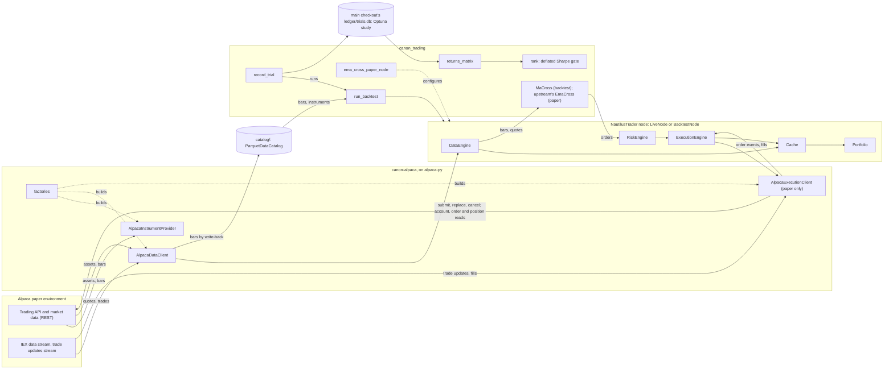

# Architecture

How the pieces fit together on `main`. Each statement names the file or record it rests on; the records
outrank this page. What is planned is in [roadmap.md](roadmap.md).

## Layers

| Layer | What it is | Rests on (pin) | Code | Decided by |
|---|---|---|---|---|
| Venue | Alpaca's paper Trading API, its market data (IEX feed) and its two streams | Alpaca's docs; `alpaca-py` v0.45.0 | none here | ADR 0009 |
| Adapter | Instrument provider, data client, execution client, factories, in upstream's five modules | `alpaca-py` v0.45.0; `requests` v2.34.2, for the HTTP timeout alpaca-py does not set; NautilusTrader's adapter guide and template (template at v2.0.0rc8) | `packages/canon-alpaca/` | ADR 0009, 0012, 0024, 0030, 0036, 0038, 0039, 0042 |
| Engine | The node: data, risk and execution engines, cache, portfolio; `BacktestNode` for backtests, `LiveNode` for paper | NautilusTrader v2.0.0rc8 | upstream | ADR 0009 |
| Strategies and node configuration | `MaCross` and `run_backtest` on a simulated `ALPACA` venue; `ema_cross_paper_node`, a paper `LiveNode` running upstream's built-in `EmaCross` under risk limits | NautilusTrader v2.0.0rc8 | `src/canon_trading/` | ADR 0009, 0012, 0037 |
| Local data | `ParquetDataCatalog` of bars and instruments, ignored by git, filled from Alpaca by `load_bars` | NautilusTrader v2.0.0rc8 | `catalog/`, `canon_trading/bars_to_catalog.py` | ADR 0012, 0040 |
| Trial ledger | One Optuna trial per backtest, in a SQLite study over a fixed sample, in the main checkout and shared by every worktree, ignored by git | Optuna v5.0.0 | `canon_trading/ledger.py`, `ledger/` | ADR 0010, 0035, 0041 |
| Returns matrix | T daily rows, the session days every trial covers over the sample, one column per configuration | pandas v3.1.1; skfolio v1.12.8 `Population` | `canon_trading/returns_matrix.py` | ADR 0010, 0041 |
| Gate | The pick's deflated Sharpe ratio against 0.95, N = every trial | skfolio v1.12.8 | `canon_trading/ranking.py` | ADR 0010, 0031 |

Pins are in `canon/upstreams.json` and `pyproject.toml`, commits in `canon/upstreams.lock.json`. The
adapter is a uv workspace member of its own, kept apart from strategies as upstream keeps them
(ADR 0012; `.claude/rules/trading-safety.md`). Its module layout and limits are in
`packages/canon-alpaca/README.md`.

## A backtest, from catalog to gate

1. Bars and their instrument are in a catalog: from Alpaca through `load_bars`, a `LiveNode` request with
   the catalog's write-back (ADR 0040), or generated, as `tests/test_backtest.py` writes them.
2. `run_backtest` builds one `BacktestNode` per run on a simulated `ALPACA` venue: `NETTING`, `CASH`,
   `L1_MBP` bar execution, a zero-rate fee model; no slippage, latency or market-hours model (`backtest.py`).
3. `record_trial` asks the study for a trial, runs it over the study's sample, and tells it `COMPLETE`
   (traded) or `FAIL` (failed, idle, or traded with a Sharpe ratio that is not finite), with its config
   key, sample, range, daily returns, session days and data digest (`ledger.py`, ADR 0035, ADR 0041).
4. `returns_matrix` keeps only daily series and drops closed days; a trial that does not cover every
   session day of the sample stops the ranking, with nothing trimmed, through skfolio's `Population`
   and pandas (`returns_matrix.py`, ADR 0010 step 2, ADR 0041).
5. `rank` picks the highest Sharpe ratio and rejects it below a DSR of 0.95; it stops on any input
   ADR 0031, ADR 0035 and ADR 0041 refuse (`ranking.py`).

## A paper run, from stream to fill

1. A `LiveNode` gets the adapter's factories, both or the data one alone in its paper tests, or both through `ema_cross_paper_node`,
   which adds upstream's `EmaCross` at one share an order (`paper_node.py`, `tests/test_paper_ema_cross.py`, ADR 0037),
   or through `session_window.window_node`, which adds `SessionMaCross` and the `PositionCap` with the
   execution engine's open-order and position checks on (`session_window.py`, ADR 0044).
2. On connect the provider loads `Equity` instruments from `/v2/assets`; the data client streams IEX
   quotes and trades and serves historical bars into the data engine (package README).
3. A strategy's order passes the risk engine, then the execution engine sends it to Alpaca's paper API
   with `paper=True`; denied types never reach Alpaca (package README, ADR 0036).
4. Alpaca's trade updates stream becomes order events; each `fill` or `partial_fill` is an `OrderFilled`
   keyed by Alpaca's `execution_id` (package README, ADR 0024).
5. At start-up the client reports orders, fills from Alpaca's fill activities, open positions, and each
   loaded instrument without a position as flat, for reconciliation (package README, ADR 0024).

## Safety boundaries

* **Paper only.** `AlpacaExecutionClientConfig` refuses `paper` other than `True`, any `url_override`
  and any value naming Alpaca's live host, and the client builds alpaca-py's clients with `paper=True`
  whatever the config holds; `test_upstream_contract.py` asserts alpaca-py's trading clients default to
  paper (package README, ADR 0009, ADR 0030). Agents never place, modify or cancel a live order, and
  the record keeps trading on paper at least until NautilusTrader v2.0.0 stable (ADR 0009).
* **The key pair** is in the login keychain, service `canon-alpaca-paper`. Of this repo's commands only
  `mise run paper:test` and `mise run paper:session` put it in an environment, each its own, under one
  lock (`mise.toml`, ADR 0029, ADR 0044); it is checked against the paper API before it is stored (ADR 0033).
* **A session window** holds a position of at most one share: `PositionCap` reads the portfolio every second
  inside the node and shuts the system down over it; the window starts flat, ends flat or fails, and lasts
  at most 60 minutes (ADR 0044).
* **The risk engine** limits submits and modifies only; cancels and queries pass it. `ema_cross_paper_node`
  sets 50 submits and 25 modifies a minute, under Alpaca's working figure of 200 calls a minute, and
  $1,000 notional per order; its paper test allows one submit in five minutes (ADR 0037). The adapter's
  tester nodes turn the engine off (`LiveRiskEngineConfig(bypass=True)` in `test_paper_matrix.py` and
  `test_paper_execution.py`); a node that sets no limits has upstream's defaults, 100 a second each and
  no notional limit (the pinned package's `RiskEngineConfig`). Where the engine is on, a market order
  with no price is denied (package README).
* **Not enforced by code.** The keychain does not keep a process of this user from reading the pair;
  "agents never read a credential" is an instruction (ADR 0029). No hook runs before a tool call
  (ADR 0020), and the sandbox is not on (ADR 0025). That no live key is on the machine is unverified
  (ADR 0025).

## The harness

* **Canon.** Every upstream is in `canon/upstreams.json` with role, licence, evidence and record;
  `scripts/canon resolve` writes the commits to the lock (ADR 0001).
* **Records.** Decisions are MADR 4.0.0 with an Evidence section and a `review-by` date, re-verified
  after it (ADR 0002); `scripts/canon lint` checks them.
* **One check.** `scripts/ci` runs every check, on every commit through `.githooks/pre-commit` and on
  GitHub (ADR 0013).
* **Landing.** `scripts/land` runs the check and squash-merges the branch; a change outside a named few
  needs a review note, recorded as the `review` status (ADR 0014, ADR 0017, ADR 0019).
* **Reviewer benchmark.** Past commits whose defects a fix and a failing test later confirmed, one brief
  for every reviewer, found-or-missed scoring by two scorers (`evals/review/`, ADR 0046). First run
  2026-11-10, scored in `evals/review/runs/2026-11-10-first/`; the cases hold 21 confirmed defects, 10 in
  `order-modify`.
* **Unasked.** The commit gate, the push address check, edit-time lint, a daily canon watch, a lane
  watchdog, a weekly model run and Dependabot (ADR 0011, ADR 0016, ADR 0026; `AGENTS.md`, "Automation").
  Once installed, a paper session window every 35 minutes, run from a clone each firing brings to
  GitHub's `main` first, never from a checkout a person uses (ADR 0047).
  Models are routed by lane in `canon/models.json` (ADR 0005).
